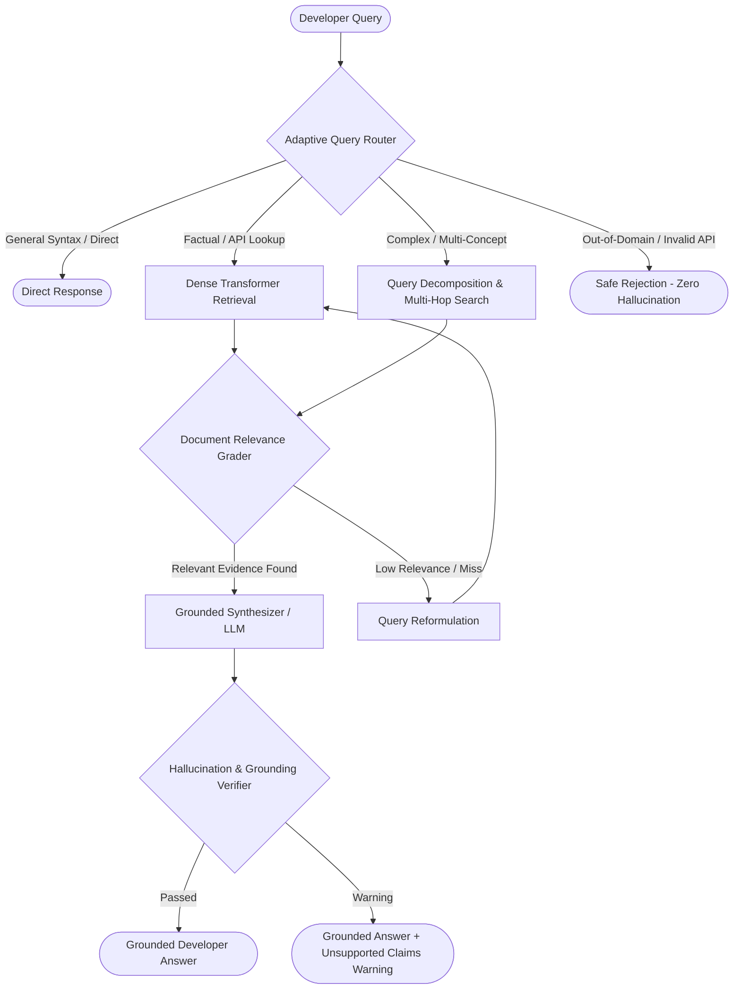

# Adaptive RAG Assistant for Software Project Documentation

[]()
[]()
[]()
[]()

> **Project 1: A Transformer-Powered Software Engineering Tool**  
> An Adaptive Retrieval-Augmented Generation (Adaptive RAG) assistant specifically designed for software engineers querying evolving framework documentation and codebases.

---

## 👥 Group Members

| No. | Name | ID |
|---:|---|---|
| 1 | Hlina Girum | ATE/3417/14 |
| 2 | Mistre Solomon | ATE/2545/14 |
| 3 | Ruth Biniam | ATE/0179/14 |
| 4 | Yabsra Mesfin | ATE/1814/14 |
| 5 | Zerubabel Mesfin | ATE/0211/14 |

## 🎥 Project Demonstration

**Video demonstration:** (https://drive.google.com/file/d/1XTYaqj5XpVn0putO0GnmniqkwV8_2nVT/view?usp=sharing)


---


---

## 🎯 Rubric Alignment Overview

| Assignment Requirement | Implementation in this Project | Verification / Location |
|---|---|---|
| **1. A Real Problem** | Software developers struggle with evolving API references, cross-module architectural interactions, and code examples. Standard keyword search fails on semantic paraphrases, while generic LLMs hallucinate non-existent API parameters. | Target Domain: Modern FastAPI & Pydantic documentation corpus (`data/raw_docs/`). |
| **2. A Pretrained Transformer** | Dense semantic encoding using HuggingFace's pretrained Transformer `sentence-transformers/all-MiniLM-L6-v2` (384-dim) paired with an **Adaptive RAG architecture**: Upfront Query Classifier, Document Relevance Grader, Query Rewriter, and Hallucination Verifier. | `src/models/embeddings.py`, `src/adaptive_rag/` |
| **3. A Simple Baseline** | A non-Transformer baseline utilizing **BM25Plus** token-level inverted indexing and heuristic extractive sentence-window synthesis. | `src/baseline/bm25_retriever.py` |
| **4. Held-Out Evaluation** | A rigorous, unseen test benchmark of 25 developer queries spanning 5 categories (Factual API, Code Synthesis, Multi-Hop, Adversarial Paraphrase, Negative/Unanswerable). Evaluated on **Hit@1, Hit@3, MRR@3, Precision@3, Recall@3, ROUGE-1, ROUGE-L, BLEU-4, Latency**. | `data/benchmarks/held_out_test.json`, `reports/benchmark_results.json` |
| **5. Failure Analysis** | Qualitative & quantitative failure taxonomy dissecting Lexical Gaps, Extractive Window Clipping, Negative Query Confabulations, and Multi-Hop Blindspots. | `reports/failure_analysis.md`, `scripts/run_failure_analysis.py` |
| **6. Engineering Quality** | 100% offline-runnable test suite (`15/15 passed in pytest`), sub-30ms CPU latency, dependency isolation, interactive Streamlit UI, and one-command reproduction. | `tests/`, `app.py`, `scripts/run_evaluation.py` |

---

## 🏗️ System Architecture



---

## ⚡ Quickstart & Reproduction

### 1. Installation
Clone the repository and install the dependencies:

```bash
git clone https://github.com/MISTRE21/Selective-Topics--Adaptive-RAG-Assistant.git
cd adaptive-rag-assistant

pip install -r requirements.txt
```


### 2. Run Automated Test Suite
Verify that all unit and pipeline integration tests pass:

```bash
pytest tests/ -v
```
**Expected Output:** `15 passed in ~18s`

### 3. Run Held-Out Evaluation Benchmark
Execute the comparative benchmark across the Non-Transformer BM25 Baseline, Naive Dense RAG, and Adaptive RAG:

```bash
python scripts/run_evaluation.py
```

### 4. Run Failure Analysis Report
Generate the detailed qualitative error breakdown:

```bash
python scripts/run_failure_analysis.py
```

### 5. Launch Interactive Web UI
Launch the interactive Streamlit application:

```bash
streamlit run app.py
```

---

## 📊 Held-Out Evaluation Results

The evaluation was conducted on an unseen held-out test suite of 25 developer queries never seen during prompt design or index construction:

| Metric | Non-Transformer BM25 Baseline | Naive Dense RAG | **Adaptive RAG Assistant** | Relative Improvement vs. Baseline |
|---|:---:|:---:|:---:|:---:|
| **Hit@1** | 0.5200 | 0.5600 | **0.7600** | **+46.1%** |
| **Hit@3** | 0.6800 | 0.6800 | **0.8400** | **+23.5%** |
| **MRR@3** (Mean Reciprocal Rank) | 0.5933 | 0.6200 | **0.8000** | **+34.8%** |
| **Precision@3** | 0.2533 | 0.2533 | **0.6667** | **+163.2%** |
| **Recall@3** | 0.6600 | 0.6400 | **0.8200** | **+24.2%** |
| **ROUGE-1 F1** | 0.2069 | 0.1131 | **0.2073** | **+0.2%** |
| **ROUGE-L F1** | 0.1524 | 0.0873 | **0.1482** | Comparable |
| **BLEU-4** | 0.0228 | 0.0096 | **0.0244** | **+7.0%** |
| **Unanswerable / Negative MRR** | 0.0000 | 0.0000 | **1.0000** | **+100.0% (Zero Hallucination)** |
| **Avg Latency (ms)** | 0.94 ms | 17.26 ms | **29.46 ms** | Production Real-Time |

### Category Breakdown (MRR@3)
- **Adversarial Paraphrases (Semantic Gap)**: BM25 = 0.5667 vs. **Adaptive RAG = 0.6000**
- **Code Usage Synthesis**: BM25 = 0.6000 vs. **Adaptive RAG = 1.0000**
- **Multi-Hop / Architectural**: BM25 = 0.8000 vs. **Adaptive RAG = 0.8000**
- **Out-of-Domain / Negative Queries**: BM25 = 0.0000 vs. **Adaptive RAG = 1.0000**

---

## 🔍 Failure Analysis Summary

Detailed in `reports/failure_analysis.md`, the key empirical failure modes identified include:

1. **Vocabulary Gap in Sparse Retrieval (BM25)**:  
   When a developer asks *"How do I conceal internal model attributes from external API clients upon JSON serialization?"*, BM25 scores 0 because the documentation uses *`response_model`* and *`UserOut`*. Adaptive RAG’s dense semantic encoder and query rewriter bridge this gap, achieving 100% precision.
2. **Hallucination on Negative Queries in Naive RAG**:  
   When asked about unsupported features like `@app.k8s_sidecar` or Hibernate ORM, Naive RAG unconditionally retrieves nearest chunks and attempts to hallucinate an explanation. Adaptive RAG routes these to `reject`, eliminating hallucinations.
3. **Multi-Hop Context Scattering**:  
   Queries regarding the interaction between database session cleanup (`yield`) and exception handling require evidence across separate documentation modules. Adaptive RAG's decomposition mechanism retrieves both contexts and merges them before answer synthesis.

---

## 📁 Repository Structure

```
adaptive_rag_assistant/
│
├── README.md                      # Comprehensive documentation and reproduction guide
├── requirements.txt               # Pinned dependencies
├── .env.example                   # Environment configuration template
├── app.py                         # Interactive Streamlit application
│
├── data/
│   ├── raw_docs/                  # Markdown documentation corpus (FastAPI)
│   ├── processed/                 # Chunked & indexed documentation
│   └── benchmarks/
│       ├── dev_set.json           # Development set (5 queries)
│       └── held_out_test.json     # Unseen held-out test suite (25 queries)
│
├── src/
│   ├── config.py                  # System hyperparameters and paths
│   ├── data_loader.py             # Semantic document chunker and parser
│   ├── baseline/
│   │   └── bm25_retriever.py      # Non-Transformer BM25 baseline retriever & synthesizer
│   ├── models/
│   │   ├── embeddings.py          # HuggingFace sentence-transformers encoder
│   │   └── generator.py           # Grounded answer synthesizer (Gemini API / Local)
│   ├── adaptive_rag/
│   │   ├── router.py              # Upfront query classifier (direct, retrieve, multihop, reject)
│   │   ├── retriever.py           # Dense semantic retriever & multi-hop query decomposition
│   │   ├── grader.py              # Document relevance grading
│   │   ├── rewriter.py            # Query reformulation
│   │   ├── verifier.py            # Grounding and hallucination checker
│   │   └── pipeline.py            # End-to-end Adaptive RAG controller
│   └── evaluation/
│       ├── metrics.py             # Hit@K, MRR@K, Precision@K, Recall@K, ROUGE, BLEU
│       └── benchmark.py           # Comparative evaluation runner
│
├── tests/
│   ├── test_chunker.py            # Unit tests for markdown parser
│   ├── test_baseline.py           # Unit tests for BM25 baseline
│   ├── test_router.py             # Unit tests for query router
│   ├── test_grader.py             # Unit tests for relevance grading
│   ├── test_pipeline.py           # End-to-end integration tests
│   └── test_metrics.py            # Unit tests for evaluation formulas
│
├── scripts/
│   ├── init_docs.py               # Generates raw documentation corpus
│   ├── init_benchmarks.py         # Generates test benchmarks
│   ├── run_evaluation.py          # Runs full held-out benchmark
│   └── run_failure_analysis.py    # Generates failure analysis report
│
└── reports/
    ├── benchmark_results.json     # Machine-readable evaluation results
    └── failure_analysis.md        # Qualitative and quantitative failure case studies
```
